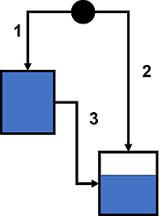
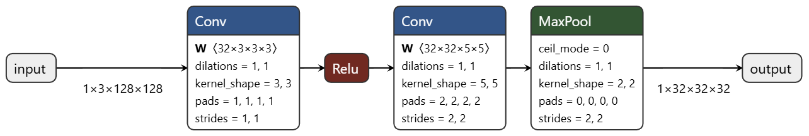
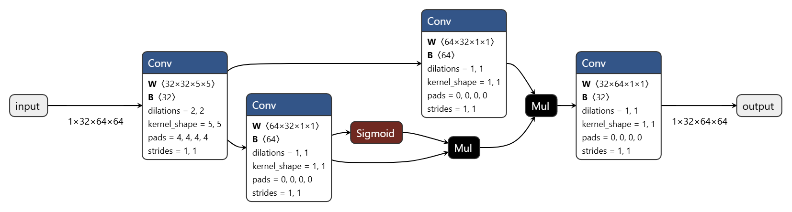
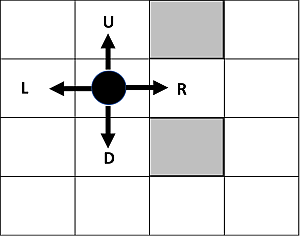

Trí tuệ nhân tạo
================

Bài 1. Entropy của phân phối dự đoán (5 điểm)
---------------------------------------------

Đề bài
^^^^^^

Một bộ phân loại có 4 lớp :math:`(A, B, C, D)`. Trên một mẫu cụ thể, phân phối xác suất dự đoán của mạng nơ-ron :math:`(p_A, p_B, p_C, p_D)` thỏa các điều kiện:

- :math:`p_A = p_B`;
- :math:`p_C = 2 p_D`;
- :math:`p_A + p_B + p_C + p_D = 1`.

Cần tìm phân phối xác suất làm cực đại entropy của phân phối dự đoán (tức là làm cho dự đoán "đa dạng" nhất trong phạm vi các ràng buộc đã cho):

.. math:: H = -\sum_{i \in \{ A, B, C, D \}} p_i \log_2 p_i.

**Định dạng đáp án.** Bốn số :math:`(p_A, p_B, p_C, p_D)`, mỗi số làm tròn đến chữ số thập phân thứ ba, cách nhau bởi dấu cách.

Lời giải
^^^^^^^^

Đặt :math:`p_A = p_B = a`, :math:`p_D = d`, :math:`p_C = 2d`. Ràng buộc còn lại là :math:`2a + 3d = 1`. Khi đó

.. math::

   H(a, d) = -2a \log_2 a - 2d \log_2 (2d) - d \log_2 d = -2a \log_2 a - 3d \log_2 d - 2d.

Hàm :math:`H` lõm và ràng buộc tuyến tính nên điểm dừng của hàm Lagrange là điểm cực đại. Từ

.. math::

   \frac{\partial H}{\partial a} = -2 \left( \log_2 a + \frac{1}{\ln 2} \right) = 2 \lambda, \quad
   \frac{\partial H}{\partial d} = -3 \left( \log_2 d + \frac{1}{\ln 2} \right) - 2 = 3 \lambda

suy ra :math:`\log_2 a = \log_2 d + \dfrac{2}{3}`, tức :math:`a = 2^{2/3} d`. Thay vào ràng buộc:

.. math::

   d = \frac{1}{3 + 2^{5/3}} \approx 0.16195, \quad a = 2^{2/3} d \approx 0.25708, \quad p_C = 2d \approx 0.32389.

**Đáp án:** ``0.257 0.257 0.324 0.162``.

Bài 2. Gradient theo thời gian (5 điểm)
---------------------------------------

Đề bài
^^^^^^

*Bài do Viện các vấn đề điều khiển V.A. Trapeznikov (Viện Hàn lâm Khoa học Nga) cung cấp, với sự hỗ trợ của Hiệp hội Trí tuệ nhân tạo Nga.*

Trong một kim tự tháp Ai Cập, người ta xây một cái bẫy dành cho kẻ trộm mộ, điều khiển bởi một cỗ máy thủy lực. Cỗ máy gồm hai bể chứa có cùng thể tích :math:`V = 10` lít, nối với nhau bằng các ống như hình vẽ.

Ban đầu cả hai bể đều rỗng. Khi có người bước vào hầm mộ, ống 1 và ống 2 mở ra. Khi bể thứ nhất đầy, một tiếng cồng cảnh báo vang lên và ống 3 mở ra. Khi bể thứ hai đầy, một cửa sập trên sàn mở ra và vị khách không mời rơi xuống. Các thầy tu muốn chỉnh các ống sao cho tiếng cồng vang lên sau :math:`t^* = 2` giây kể từ lúc bắt đầu, và sau đó :math:`d = 2` giây nữa thì cửa sập mở. Rắc rối là sau mỗi lần kích hoạt lại phải chỉnh lại các ống. Một thầy tu thông thái đề xuất chỉnh các ống bằng phương pháp lan truyền ngược sai số. Ông dùng hàm sai số sau:

.. math:: E = \frac{1}{2} (t_1 - t^*) + \frac{1}{2} (t_2 - t_1 - d),

trong đó :math:`t_1`, :math:`t_2` là thời điểm bể 1 và bể 2 đầy ứng với lưu lượng hiện tại của các ống. Tính đạo hàm của sai số :math:`E` theo lưu lượng của ống 3, nếu hiện tại lưu lượng các ống lần lượt là :math:`w_1 = 5` l/s, :math:`w_2 = 2` l/s, :math:`w_3 = 2` l/s.

**Định dạng đáp án.** Giá trị đạo hàm, chính xác đến 4 chữ số sau dấu phẩy.

Lời giải
^^^^^^^^

Bể 1 chỉ nhận nước từ ống 1 nên :math:`t_1 = V / w_1 = 2` s và :math:`t_1` không phụ thuộc :math:`w_3`.

Bể 2 nhận nước từ ống 2 với lưu lượng :math:`w_2` ngay từ đầu, và từ ống 3 với lưu lượng :math:`w_3` kể từ thời điểm :math:`t_1` (do :math:`w_1 \geqslant w_3` nên bể 1 luôn đầy và ống 3 chảy đúng :math:`w_3`). Do đó

.. math::

   V = w_2 t_2 + w_3 (t_2 - t_1) \Longrightarrow t_2 = \frac{V + w_3 t_1}{w_2 + w_3} = \frac{10 + 4}{4} = 3.5.

Đạo hàm theo :math:`w_3`:

.. math::

   \frac{\partial t_2}{\partial w_3} = \frac{t_1 (w_2 + w_3) - (V + w_3 t_1)}{(w_2 + w_3)^2} = -\frac{t_2 - t_1}{w_2 + w_3} = -\frac{1.5}{4} = -0.375.

Vì số hạng đầu của :math:`E` không phụ thuộc :math:`w_3` nên

.. math::

   \frac{\partial E}{\partial w_3} = \frac{1}{2} \frac{\partial t_2}{\partial w_3} = -0.1875.

.. note::

   Hàm sai số trong đề được viết dạng tuyến tính và đáp án :math:`-0.1875` khớp với cách viết đó. Nếu hàm sai số là dạng bình phương quen thuộc :math:`\frac{1}{2}(t_1 - t^*)^2 + \frac{1}{2}(t_2 - t_1 - d)^2` thì đạo hàm là :math:`(t_2 - t_1 - d) \cdot (-0.375) = 0.1875`.

**Đáp án:** ``-0.1875``.

Bài 3. Bước nhỏ nhất (5 điểm)
-----------------------------

Đề bài
^^^^^^

*Bài do Trung tâm mô hình hóa nhận thức MIPT cung cấp.*

Xét hàm mất mát

.. math:: L(x, y) = 5(x-2)^2 + (y-1)^2.

Trạng thái ban đầu và quy luật chuyển động (gradient descent với momentum) như sau:

.. math:: (x_0, y_0) = (0, 0), \quad v_0 = (0, 0),

.. math:: v_t = \beta v_{t-1} - \eta \nabla L(x_{t-1}, y_{t-1}), \quad (x_t, y_t) = (x_{t-1}, y_{t-1}) + v_t,

trong đó :math:`\beta = 0.8` là hệ số momentum, :math:`\eta > 0` là bước học.

Tìm giá trị dương nhỏ nhất của :math:`\eta`, làm tròn đến chữ số thập phân thứ ba, sao cho sau hai bước thuật toán đạt đúng điểm cực tiểu của :math:`L(x, y)` theo :math:`x`.

Lời giải
^^^^^^^^

Hai tọa độ độc lập với nhau nên chỉ cần xét :math:`x`, với :math:`\partial L / \partial x = 10(x - 2)`.

- Bước 1: :math:`v_1 = -\eta \cdot 10(0 - 2) = 20 \eta`, :math:`x_1 = 20 \eta`.
- Bước 2: :math:`v_2 = 0.8 \cdot 20 \eta - \eta \cdot 10 (20\eta - 2) = 36 \eta - 200 \eta^2`, :math:`x_2 = 56 \eta - 200 \eta^2`.

Điều kiện :math:`x_2 = 2` cho phương trình

.. math:: 100 \eta^2 - 28 \eta + 1 = 0 \Longleftrightarrow \eta = \frac{14 \pm 4\sqrt{6}}{100}.

Nghiệm dương nhỏ nhất là :math:`\eta = \dfrac{14 - 4\sqrt{6}}{100} \approx 0.04202`.

**Đáp án:** ``0.042``.

Bài 4. Trường tiếp nhận (5 điểm)
--------------------------------

Đề bài
^^^^^^

*Bài do Trung tâm mô hình hóa nhận thức MIPT cung cấp.*

Xét mạng nơ-ron tích chập có kiến trúc như hình vẽ (ý nghĩa các thuộc tính của từng khối xem trong tài liệu của các toán tử Conv, ReLU, MaxPool).

Đầu vào của mạng là tensor kích thước :math:`3 \times 128 \times 128`, trong đó chiều thứ nhất là số kênh, hai chiều còn lại là chiều cao và chiều rộng ảnh.

Cần xác định kích thước trường tiếp nhận (receptive field) của phần tử :math:`y_{i, j}` của tensor đầu ra. Nói cách khác, cần tìm kích thước vùng của tensor đầu vào mà việc thay đổi giá trị trong vùng đó có thể ảnh hưởng đến :math:`y_{i, j}`. Ở đây :math:`y_{i, j}` là phần tử bất kỳ có trường tiếp nhận nằm trọn trong ảnh đầu vào, không vượt ra ngoài biên.

**Định dạng đáp án.** Hai số nguyên cách nhau bởi dấu cách: chiều cao và chiều rộng của trường tiếp nhận.

Lời giải
^^^^^^^^

Gọi :math:`r_l` là kích thước trường tiếp nhận và :math:`j_l` là "bước nhảy" (khoảng cách trên ảnh gốc giữa hai phần tử kề nhau) sau tầng thứ :math:`l`. Với tầng có kernel :math:`k`, dilation :math:`\delta` và stride :math:`s`:

.. math:: r_l = r_{l-1} + (k - 1) \delta \, j_{l-1}, \quad j_l = j_{l-1} s, \quad r_0 = j_0 = 1.

ReLU là phép toán từng phần tử nên không làm thay đổi trường tiếp nhận. Hai chiều giống hệt nhau:

=================================== ===== ======
Tầng                                 r     j
=================================== ===== ======
Đầu vào                              1     1
Conv 3×3, stride 1                   3     1
ReLU                                 3     1
Conv 5×5, stride 2                   7     2
MaxPool 2×2, stride 2                9     4
=================================== ===== ======

Kiểm tra kích thước: :math:`128 \to 128 \to \lfloor (128 + 4 - 5)/2 \rfloor + 1 = 64 \to 32`, khớp với đầu ra :math:`1 \times 32 \times 32 \times 32` trên hình.

**Đáp án:** ``9 9``.

Bài 5. Dấu chân carbon (5 điểm)
-------------------------------

Đề bài
^^^^^^

*Bài do Trung tâm khoa học - giáo dục mô hình hóa nhận thức MIPT cung cấp.*

Hình dưới mô tả một mô hình mạng nơ-ron nhận vào và trả ra tensor cùng kích thước :math:`\langle 1 \times 32 \times 64 \times 64 \rangle`. Đồ thị tính toán (các mũi tên) gồm các khối:

- Conv: phép tích chập, :math:`W` là tensor trọng số, :math:`B` là tensor bias, tham số groups = 1;
- Sigmoid: hàm kích hoạt sigmoid;
- Mul: phép nhân từng phần tử.

Đồ thị tính toán có thể được đặc trưng bởi số FLOPs (floating point operations). Một FLOP là một phép trừ, cộng, nhân, chia hai số, v.v. Ví dụ, với :math:`a, b \in \mathbb{R}^n` và :math:`c, d \in \mathbb{R}`:

- :math:`a + b` cần :math:`n` FLOPs;
- :math:`c \cdot a` cần :math:`n` FLOPs;
- :math:`c \cdot d \cdot a` cần :math:`n + 1` phép nếu tính :math:`(c \cdot d) \cdot a` và :math:`2n` phép nếu tính :math:`c \cdot (d \cdot a)`: khi đó chọn thứ tự tối ưu (ít phép tính nhất);
- các thao tác gán giá trị hay đổi kích thước tensor tốn :math:`0` FLOP.

Với các hàm phức tạp, số FLOPs phụ thuộc cách cài đặt. Quy ước :math:`e^x` tốn đúng :math:`100` FLOPs.

Giả sử 1 FLOP tương đương với việc thải ra :math:`4 \cdot 10^{-13}` kg CO\ :sub:`2`. Hãy tính dấu chân carbon của một lần chạy mô hình.

**Định dạng đáp án.** Một số dương: dấu chân carbon tính theo kg, nhân với :math:`10^4`, làm tròn đến chữ số thập phân thứ hai.

Lời giải
^^^^^^^^

Mọi tensor trung gian đều có kích thước không gian :math:`64 \times 64` (tích chập đầu có kernel :math:`5 \times 5`, dilation 2, nên kernel hiệu dụng là :math:`9 \times 9` và padding 4 giữ nguyên kích thước). Đặt :math:`S = 64 \cdot 64 = 4096`.

Với một phần tử đầu ra của tích chập có :math:`C_{in}` kênh vào và kernel :math:`k \times k`: cần :math:`C_{in} k^2` phép nhân, :math:`C_{in} k^2 - 1` phép cộng và 1 phép cộng bias, tổng cộng :math:`2 C_{in} k^2` FLOPs. Do đó một lớp Conv tốn :math:`2 C_{in} k^2 \cdot C_{out} \cdot S` FLOPs (tính cả các vị trí padding bằng 0, theo quy ước thông thường).

Sigmoid :math:`\sigma(x) = 1 / (1 + e^{-x})` tốn :math:`1` (đổi dấu) :math:`+ 100` (mũ) :math:`+ 1` (cộng) :math:`+ 1` (chia) :math:`= 103` FLOPs cho mỗi phần tử.

========================================== ===================================== ===============
Khối                                       Công thức                             FLOPs
========================================== ===================================== ===============
Conv :math:`32 \to 32`, :math:`5 \times 5` :math:`2 \cdot 32 \cdot 25 \cdot 32 S` 209 715 200
Conv :math:`32 \to 64`, :math:`1 \times 1` :math:`2 \cdot 32 \cdot 64 S`         16 777 216
Conv :math:`32 \to 64`, :math:`1 \times 1` :math:`2 \cdot 32 \cdot 64 S`         16 777 216
Sigmoid                                    :math:`103 \cdot 64 S`                27 000 832
Mul (hai khối)                             :math:`2 \cdot 64 S`                  524 288
Conv :math:`64 \to 32`, :math:`1 \times 1` :math:`2 \cdot 64 \cdot 32 S`         16 777 216
**Tổng**                                                                         287 571 968
========================================== ===================================== ===============

Lượng CO\ :sub:`2` là :math:`287\,571\,968 \cdot 4 \cdot 10^{-13} \approx 1.1503 \cdot 10^{-4}` kg. Nhân với :math:`10^4` được :math:`1.15`.

Nếu không tính phép đổi dấu trong sigmoid (102 FLOPs/phần tử) thì kết quả là :math:`1.1492`, vẫn làm tròn thành :math:`1.15`.

**Đáp án:** ``1.15``.

Bài 6. Linear attention (7 điểm)
--------------------------------

Đề bài
^^^^^^

*Bài do Trung tâm mô hình hóa nhận thức MIPT cung cấp.*

Xét một khối mạng nơ-ron cho bởi công thức

.. math:: o_t = \sum_{j=1}^t \left( q_t^{\top}\left( \prod_{s=j+1}^t \text{Diag}(\alpha_s) \right) k_j \right) v_j,

trong đó :math:`\alpha_s` là vector hệ số suy giảm theo từng phần tử ở bước :math:`s`, :math:`\text{Diag}(\alpha_s)` là ma trận đường chéo với các phần tử của :math:`\alpha_s`, :math:`q_t` và :math:`k_j` là các hàng của ma trận :math:`Q` và :math:`K`, :math:`v_j` là các hàng của ma trận :math:`V`.

Cho các ma trận :math:`A`, :math:`C`, :math:`V` kích thước :math:`L \times d` là các đầu vào đã được biến đổi:

.. math:: A = Q \odot B, \quad C = K / B,

trong đó :math:`B` là hệ số tích lũy :math:`B_t = \prod_{s=1}^t \alpha_s`, còn :math:`\odot` và :math:`/` là phép nhân và phép chia từng phần tử.

Từ dữ liệu đầu vào, hãy tính ma trận đầu ra :math:`O`.

**Định dạng đầu vào.** Dòng đầu gồm hai số nguyên dương :math:`L` và :math:`d`. Tiếp theo là :math:`L` dòng của ma trận :math:`A`, :math:`L` dòng của ma trận :math:`C`, :math:`L` dòng của ma trận :math:`V`; mỗi dòng gồm :math:`d` số thực cách nhau bởi dấu cách.

**Định dạng đầu ra.** :math:`L` dòng của ma trận :math:`O`, mỗi dòng :math:`d` số thực.

**Chấm điểm.** Đáp án đúng nếu sai số tương đối của mỗi giá trị không vượt quá :math:`10^{-5}`.

Lời giải
^^^^^^^^

**Mệnh đề.** :math:`q_t^{\top}\left( \prod_{s=j+1}^t \text{Diag}(\alpha_s) \right) k_j = \langle a_t, c_j \rangle`, với :math:`a_t, c_j` là hàng thứ :math:`t` của :math:`A` và hàng thứ :math:`j` của :math:`C`.

.. admonition:: Chứng minh
   :class: danger, dropdown

   Tích các ma trận đường chéo là ma trận đường chéo với các phần tử nhân với nhau, nên

   .. math::

      \prod_{s=j+1}^t \text{Diag}(\alpha_s) = \text{Diag}\left( \prod_{s=j+1}^t \alpha_s \right) = \text{Diag}\left( \frac{B_t}{B_j} \right).

   Do đó

   .. math::

      q_t^{\top} \text{Diag}\left( \frac{B_t}{B_j} \right) k_j
      = \sum_{m=1}^d q_{t,m} \frac{B_{t,m}}{B_{j,m}} k_{j,m}
      = \sum_{m=1}^d (q_{t,m} B_{t,m}) \cdot \frac{k_{j,m}}{B_{j,m}}
      = \langle a_t, c_j \rangle.

Như vậy :math:`o_t = \sum_{j \leqslant t} \langle a_t, c_j \rangle v_j`, hay viết dạng ma trận

.. math:: O = \left( (A C^{\top}) \odot M \right) V,

với :math:`M` là ma trận tam giác dưới gồm toàn số 1 (kể cả đường chéo), giống causal attention nhưng không có softmax. Độ phức tạp :math:`O(L^2 d)`. Nếu :math:`L` lớn có thể dùng dạng hồi quy :math:`S_t = S_{t-1} + c_t^{\top} v_t`, :math:`o_t = a_t S_t` với độ phức tạp :math:`O(L d^2)`.

.. code-block:: python

   import sys
   import numpy as np

   def main():
       data = sys.stdin.read().split()
       L, d = int(data[0]), int(data[1])
       vals = np.array(data[2:2 + 3 * L * d], dtype=np.float64)
       A = vals[:L * d].reshape(L, d)
       C = vals[L * d:2 * L * d].reshape(L, d)
       V = vals[2 * L * d:].reshape(L, d)
       S = np.tril(A @ C.T)      # S[t, j] = <a_t, c_j> khi j <= t
       O = S @ V
       out = "\n".join(" ".join(f"{x:.12g}" for x in row) for row in O)
       sys.stdout.write(out + "\n")

   main()

Chương trình đã được kiểm tra với cách tính trực tiếp theo công thức gốc (sinh ngẫu nhiên :math:`Q, K, V, \alpha`), sai lệch không đáng kể.

Bài 7. Dòng có thể học (7 điểm)
-------------------------------

Đề bài
^^^^^^

*Bài do Trung tâm mô hình hóa nhận thức MIPT cung cấp.*

Giả sử ta muốn mô hình hóa chuyển động của các điểm trong không gian nhiều chiều từ trạng thái đầu :math:`x_0 \in \mathbb{R}^d` đến trạng thái đích :math:`x_1 \in \mathbb{R}^d` thông qua trường vector :math:`f_W(x)` được tham số hóa bởi ma trận trọng số :math:`W \in \mathbb{R}^{d \times d}` (mô tả một quá trình sinh dữ liệu bằng mạng nơ-ron).

Các điểm trung gian giữa :math:`x_0` và :math:`x_1` cho bởi

.. math:: x_t = (1 - t^p) x_0 + t^p x_1, \quad t \in [0, 1],

trong đó :math:`p > \frac{1}{2}` là tham số quyết định độ cong của quỹ đạo.

Trường vector có thể học là ánh xạ tuyến tính

.. math:: f_W(x_t) = W x_t,

dự đoán "vận tốc" chuyển động tại mỗi điểm :math:`x_t`. Mục tiêu là :math:`f_W(x_t)` xấp xỉ vận tốc thực dọc theo quỹ đạo, tức đạo hàm :math:`v(t) = \dfrac{d x_t}{dt}`. Sai số mô hình là

.. math:: e(t) = f_W(x_t) - v(t) = W x_t - \frac{d x_t}{dt},

và hàm mất mát là tích phân bình phương chuẩn của sai số theo thời gian (tương tự MSE cho quỹ đạo liên tục):

.. math:: \mathcal{L}(W) = \int_0^1 \lVert e(t) \rVert^2 \, dt.

Viết chương trình nhận :math:`(x_0, x_1, p, W)` và tính ma trận gradient :math:`\nabla_W \mathcal{L}`.

**Định dạng đầu vào.** Dòng 1: số nguyên dương :math:`d`. Dòng 2: :math:`d` số thực của :math:`x_0`. Dòng 3: :math:`d` số thực của :math:`x_1`. Dòng 4: số thực dương :math:`p > \frac{1}{2}`. Tiếp theo là :math:`d` dòng, mỗi dòng :math:`d` số thực, là các hàng của :math:`W`.

**Định dạng đầu ra.** :math:`d` dòng, mỗi dòng :math:`d` số thực, là các hàng của :math:`\nabla_W \mathcal{L}`.

**Chấm điểm.** Đáp án đúng nếu sai số tương đối của mỗi giá trị không vượt quá :math:`10^{-5}`.

Lời giải
^^^^^^^^

Đặt :math:`\Delta = x_1 - x_0`. Khi đó :math:`x_t = x_0 + t^p \Delta` và :math:`\dot{x}_t = p t^{p-1} \Delta`.

**Mệnh đề.** :math:`\nabla_W \mathcal{L} = 2 (W M - N)`, trong đó

.. math::

   M = \int_0^1 x_t x_t^{\top} dt = x_0 x_0^{\top} + \frac{x_0 \Delta^{\top} + \Delta x_0^{\top}}{p + 1} + \frac{\Delta \Delta^{\top}}{2p + 1}, \qquad
   N = \int_0^1 \dot{x}_t x_t^{\top} dt = \Delta x_0^{\top} + \frac{1}{2} \Delta \Delta^{\top}.

.. admonition:: Chứng minh
   :class: danger, dropdown

   Với :math:`e = W x - v` thì :math:`\lVert e \rVert^2 = \sum_i \left( \sum_k W_{ik} x_k - v_i \right)^2`, nên :math:`\dfrac{\partial \lVert e \rVert^2}{\partial W_{ik}} = 2 e_i x_k`, tức :math:`\nabla_W \lVert e \rVert^2 = 2 e x^{\top}`. Lấy tích phân theo :math:`t`:

   .. math::

      \nabla_W \mathcal{L} = 2 \int_0^1 (W x_t - \dot{x}_t) x_t^{\top} dt = 2 (W M - N).

   Điều kiện :math:`p > \frac{1}{2}` đảm bảo :math:`\int_0^1 \lVert \dot{x}_t \rVert^2 dt = p^2 \lVert \Delta \rVert^2 \int_0^1 t^{2p - 2} dt` hữu hạn, nên :math:`\mathcal{L}` xác định.

   Tính :math:`M`: khai triển :math:`x_t x_t^{\top} = x_0 x_0^{\top} + t^p (x_0 \Delta^{\top} + \Delta x_0^{\top}) + t^{2p} \Delta \Delta^{\top}` và dùng :math:`\int_0^1 t^p dt = \frac{1}{p+1}`, :math:`\int_0^1 t^{2p} dt = \frac{1}{2p+1}`.

   Tính :math:`N`: :math:`\dot{x}_t x_t^{\top} = p t^{p-1} \Delta x_0^{\top} + p t^{2p-1} \Delta \Delta^{\top}`, và :math:`\int_0^1 p t^{p-1} dt = 1`, :math:`\int_0^1 p t^{2p-1} dt = \frac{p}{2p} = \frac{1}{2}`.

.. code-block:: python

   import sys
   import numpy as np

   def main():
       data = sys.stdin.read().split()
       d = int(data[0])
       x0 = np.array(data[1:1 + d], dtype=np.float64)
       x1 = np.array(data[1 + d:1 + 2 * d], dtype=np.float64)
       p = float(data[1 + 2 * d])
       W = np.array(data[2 + 2 * d:2 + 2 * d + d * d], dtype=np.float64).reshape(d, d)
       D = x1 - x0
       M = (np.outer(x0, x0)
            + (np.outer(x0, D) + np.outer(D, x0)) / (p + 1)
            + np.outer(D, D) / (2 * p + 1))
       N = np.outer(D, x0) + 0.5 * np.outer(D, D)
       G = 2 * (W @ M - N)
       out = "\n".join(" ".join(f"{x:.12g}" for x in row) for row in G)
       sys.stdout.write(out + "\n")

   main()

Chương trình đã được kiểm tra bằng cách tính :math:`\mathcal{L}` bằng tích phân số rồi lấy đạo hàm số theo từng phần tử của :math:`W`.

Bài 8. Quy luật mũ (7 điểm)
---------------------------

Đề bài
^^^^^^

*Bài do Trung tâm nghiên cứu khoa học "Viện Kurchatov" - NIISI cung cấp, với sự hỗ trợ của Hiệp hội mạng nơ-ron Nga.*

Giả sử có :math:`n` "thụ thể mùi" phản ứng với một "mùi" cụ thể như sau: hoạt động của mỗi thụ thể có phân phối

.. math:: p(x_i \mid k_i) = k_i e^{-k_i x_i}, \quad i = 1, \ldots, n,

trong đó :math:`k_i \in (0.002, 0.05)` là tham số của thụ thể (phụ thuộc vào mùi), :math:`x_i \geqslant 0` là mức hoạt động của nó (làm tròn đến số nguyên gần nhất). Với mỗi mùi, vector tham số :math:`k = (k_1, \ldots, k_n)` là ngẫu nhiên và cố định, nhưng các vector này khác nhau đáng kể giữa các mùi. Mọi :math:`x_i` được sinh độc lập theo quy luật mũ ở trên. Bài cho một tập huấn luyện nhỏ gồm :math:`M` mẫu cho mỗi mùi trong :math:`C` mùi, với

.. math:: 10 \leqslant n \leqslant 100, \quad 3 \leqslant C \leqslant 10, \quad 7 \leqslant M \leqslant 100.

Cần xác định mùi có khả năng cao nhất cho một vector hoạt động kiểm tra. Có thể coi các tập dữ liệu khác biệt rõ giữa các mùi và lời giải là duy nhất.

**Định dạng đầu vào.** Dòng đầu gồm ba số nguyên dương :math:`M, C, n` cách nhau bởi dấu phẩy. Tiếp theo là ma trận :math:`CM \times n`: :math:`M` dòng đầu là các mẫu của mùi 1, :math:`M` dòng tiếp theo là của mùi 2, ..., mỗi dòng gồm :math:`n` số nguyên không âm cách nhau bởi dấu phẩy. Dòng cuối gồm :math:`n` số nguyên: hoạt động của các thụ thể với mùi chưa biết.

**Định dạng đầu ra.** Một số nguyên từ :math:`1` đến :math:`C`: số thứ tự của mùi có khả năng cao nhất.

Lời giải
^^^^^^^^

Đây là bài toán phân loại Naive Bayes với phân phối mũ (các thụ thể độc lập, tiên nghiệm các lớp bằng nhau vì số mẫu bằng nhau).

1. **Ước lượng tham số.** Với mỗi mùi :math:`c` và thụ thể :math:`i`, ước lượng hợp lý cực đại của tham số phân phối mũ là :math:`\hat{k}_{c,i} = 1 / \bar{x}_{c,i}` với :math:`\bar{x}_{c,i}` là trung bình mẫu. Vì :math:`M` có thể nhỏ, ta cắt :math:`\hat{k}` vào khoảng :math:`[0.002, 0.05]` đã biết (đồng thời xử lý trường hợp :math:`\bar{x} = 0`).

2. **Phân loại.** Chọn lớp có log-likelihood lớn nhất:

   .. math:: \hat{c} = \arg\max_c \sum_{i=1}^n \log P(x_i \mid \hat{k}_{c,i}).

   Vì :math:`x_i` đã được làm tròn, ta dùng xác suất rời rạc

   .. math::

      P(x = m \mid k) = P(m - 0.5 \leqslant X < m + 0.5) =
      \begin{cases}
         1 - e^{-0.5 k}, & m = 0, \\
         e^{-k(m - 0.5)} - e^{-k(m + 0.5)}, & m \geqslant 1.
      \end{cases}

   Với :math:`k \leqslant 0.05` thì kết quả gần như trùng với dùng mật độ :math:`k e^{-kx}`, nhưng cách này chính xác hơn khi :math:`x = 0`.

.. code-block:: python

   import sys
   import re
   import numpy as np

   K_MIN, K_MAX = 0.002, 0.05

   def log_prob(x, k):
       # log P(round(X) = x) với X ~ Exp(k)
       lo = np.maximum(x - 0.5, 0.0)
       hi = x + 0.5
       # log(e^{-k lo} - e^{-k hi}) = -k lo + log(1 - e^{-k (hi - lo)})
       return -k * lo + np.log(-np.expm1(-k * (hi - lo)))

   def main():
       rows = [list(map(int, re.findall(r"-?\d+", line)))
               for line in sys.stdin.read().splitlines() if line.strip()]
       M, C, n = rows[0]
       X = np.array(rows[1:1 + C * M], dtype=np.float64).reshape(C, M, n)
       x = np.array(rows[1 + C * M], dtype=np.float64)
       # ước lượng hợp lý cực đại của k cho từng (mùi, thụ thể)
       k = np.clip(1.0 / np.maximum(X.mean(axis=1), 1e-9), K_MIN, K_MAX)
       scores = log_prob(x[None, :], k).sum(axis=1)
       print(int(np.argmax(scores)) + 1)

   main()

Thử trên 300 bộ dữ liệu mô phỏng với :math:`k` sinh đều ngẫu nhiên trong :math:`(0.002, 0.05)` (tức là các mùi *không* được đảm bảo khác biệt rõ), chương trình đúng khoảng 97%; các ca sai đều rơi vào trường hợp :math:`n` và :math:`M` nhỏ. Thay ước lượng điểm bằng phân phối dự báo Bayes (tích phân theo :math:`k` với tiên nghiệm đều) cho kết quả y hệt, nên giữ cách đơn giản.

Bài 9. Khám phá hộp đen (7 điểm)
--------------------------------

Đề bài
^^^^^^

Gần đây bạn tìm thấy một thiết bị cũ trên gác mái. Tiếc là nó đã hỏng và bạn không nhớ nó làm gì, nên giờ nó là một hộp đen đối với bạn.

Thiết bị hoạt động như sau: dùng :math:`k` núm vặn có thể đặt :math:`k` số thực :math:`x_1, x_2, \ldots, x_k` (mỗi số từ :math:`0` đến :math:`10`) làm đầu vào, và thiết bị trả về một số thực :math:`f(x_1, \ldots, x_k)`. Trước hết, bạn muốn biết kỳ vọng và phương sai của kết quả nếu các tham số được chọn độc lập, mỗi tham số có phân phối đều trên :math:`[0, 10]`.

May mắn là cạnh thiết bị có ghi chép một số kết quả chạy. Dùng dữ liệu đó, bạn đã huấn luyện một ensemble cây quyết định :math:`\hat{f}(x_1, \ldots, x_k)`. Để ước lượng kỳ vọng và phương sai của hộp đen, hãy tính kỳ vọng và phương sai của :math:`\hat{f}` khi các :math:`x_i` được chọn độc lập, đều trên :math:`[0, 10]`.

**Định dạng đầu vào.** Dòng đầu gồm hai số nguyên :math:`n, k` (:math:`1 \leqslant n \leqslant 100`, :math:`1 \leqslant k \leqslant 10`): số cây và số tham số đầu vào.

Mô tả mỗi cây bắt đầu bằng số nguyên :math:`l` (:math:`0 \leqslant l \leqslant 6`): độ sâu của cây. Mỗi cây là cây nhị phân đầy đủ với :math:`2^l - 1` đỉnh trong và :math:`2^l` lá, mọi lá có độ sâu đúng :math:`l`. Các đỉnh trong được đánh số từ :math:`1` đến :math:`2^l - 1`, các lá từ :math:`2^l` đến :math:`2^{l+1} - 1`. Con trái của đỉnh :math:`i` là :math:`2i`, con phải là :math:`2i + 1`.

Mỗi dòng trong :math:`2^l - 1` dòng tiếp theo gồm hai số nguyên :math:`j, t` (:math:`1 \leqslant j \leqslant k`, :math:`1 \leqslant t \leqslant 9`). Dòng thứ :math:`i` nghĩa là tại đỉnh :math:`i`, nếu :math:`x_j < t` thì đi xuống con trái :math:`2i`, ngược lại (:math:`x_j \geqslant t`) thì đi xuống con phải :math:`2i + 1`.

Dòng cuối của mô tả cây gồm :math:`2^l` số nguyên :math:`c_{2^l}, \ldots, c_{2^{l+1} - 1}` (:math:`-10 \leqslant c_i \leqslant 10`): giá trị tại các lá.

Giá trị của ensemble :math:`\hat{f}` là tổng giá trị của tất cả các cây.

**Định dạng đầu ra.** Hai số thực: kỳ vọng và phương sai của :math:`\hat{f}`. Đáp án đúng nếu :math:`\dfrac{\lvert p - j \rvert}{\max \{ 1, \lvert j \rvert \}} \leqslant 10^{-6}`, với :math:`p` là đáp án của bạn và :math:`j` là đáp án của ban giám khảo.

Lời giải
^^^^^^^^

Tập các điểm :math:`x` rơi vào một lá :math:`u` là giao các điều kiện trên đường đi từ gốc đến lá, tức là một hình hộp :math:`\text{box}(u) = \prod_{j=1}^k [\ell_{u,j}, h_{u,j})` với :math:`\ell_{u,j}, h_{u,j} \in \{0, 1, \ldots, 10\}` (có thể rỗng). Gọi :math:`\mathcal{U}` là tập tất cả các lá của mọi cây (tối đa :math:`100 \cdot 64 = 6400` lá). Khi đó

.. math:: \hat{f}(x) = \sum_{u \in \mathcal{U}} c_u \mathbf{1}[x \in \text{box}(u)].

**Mệnh đề.** Với :math:`P_{uv} = P(x \in \text{box}(u) \cap \text{box}(v)) = \prod_{j=1}^k \dfrac{\max(0, \min(h_{u,j}, h_{v,j}) - \max(\ell_{u,j}, \ell_{v,j}))}{10}` ta có

.. math::

   \mathbb{E}[\hat{f}] = \sum_{u} c_u P_{uu}, \qquad
   \mathbb{E}[\hat{f}^2] = \sum_{u, v} c_u c_v P_{uv}, \qquad
   \text{Var}[\hat{f}] = \mathbb{E}[\hat{f}^2] - \mathbb{E}[\hat{f}]^2.

.. admonition:: Chứng minh
   :class: danger, dropdown

   Lấy kỳ vọng biểu diễn :math:`\hat{f}` ở trên được công thức cho :math:`\mathbb{E}[\hat{f}]`. Bình phương lên:

   .. math::

      \hat{f}(x)^2 = \sum_{u, v} c_u c_v \mathbf{1}[x \in \text{box}(u)] \mathbf{1}[x \in \text{box}(v)] = \sum_{u, v} c_u c_v \mathbf{1}[x \in \text{box}(u) \cap \text{box}(v)].

   Giao của hai hình hộp là hình hộp với cạnh thứ :math:`j` là :math:`[\max(\ell_{u,j}, \ell_{v,j}), \min(h_{u,j}, h_{v,j}))`. Do các :math:`x_j` độc lập và đều trên :math:`[0, 10]` nên xác suất rơi vào hình hộp bằng tích các độ dài cạnh chia cho 10, chính là :math:`P_{uv}`. Lấy kỳ vọng ta được công thức cho :math:`\mathbb{E}[\hat{f}^2]`.

   Công thức đúng cả khi :math:`u, v` thuộc cùng một cây: hai lá khác nhau của cùng một cây tách nhau tại một đỉnh chung nên hai hình hộp rời nhau và :math:`P_{uv} = 0`.

Ma trận :math:`P` có tối đa :math:`6400^2 \approx 4 \cdot 10^7` phần tử, mỗi phần tử tính qua :math:`k \leqslant 10` cạnh, nên ta tính theo từng khối hàng bằng numpy để không tốn quá nhiều bộ nhớ. Vì các ngưỡng là số nguyên nên mọi xác suất đều là bội của :math:`10^{-k}`, sai số dấu phẩy động không đáng kể.

.. code-block:: python

   import sys
   import numpy as np

   def main():
       data = sys.stdin.read().split()
       pos = 0
       def nxt():
           nonlocal pos
           pos += 1
           return int(data[pos - 1])
       n, k = nxt(), nxt()
       los, his, vals = [], [], []
       for _ in range(n):
           l = nxt()
           m = 2 ** l
           split = [None] + [(nxt() - 1, nxt()) for _ in range(m - 1)]
           leaf_vals = [nxt() for _ in range(m)]
           for leaf in range(m, 2 * m):
               lo = [0] * k
               hi = [10] * k
               v = leaf
               while v > 1:
                   parent = v // 2
                   j, t = split[parent]
                   if v % 2 == 0:          # con trái: x_j < t
                       hi[j] = min(hi[j], t)
                   else:                   # con phải: x_j >= t
                       lo[j] = max(lo[j], t)
                   v = parent
               los.append(lo)
               his.append(hi)
               vals.append(leaf_vals[leaf - m])
       lo = np.array(los, dtype=np.float64)
       hi = np.array(his, dtype=np.float64)
       c = np.array(vals, dtype=np.float64)
       # xác suất rơi vào từng lá
       p = np.prod(np.clip(hi - lo, 0, None) / 10, axis=1)
       mean = float(p @ c)
       # E[f^2] = sum_{u,v} c_u c_v P(lá u và lá v cùng xảy ra)
       second = 0.0
       B = 256
       for s in range(0, len(c), B):
           ilo = np.maximum(lo[s:s + B, None, :], lo[None, :, :])
           ihi = np.minimum(hi[s:s + B, None, :], hi[None, :, :])
           P = np.prod(np.clip(ihi - ilo, 0, None) / 10, axis=2)
           second += float(c[s:s + B] @ P @ c)
       var = max(second - mean * mean, 0.0)
       print(f"{mean:.10f} {var:.10f}")

   main()

Chương trình đã được so với cách vét cạn: vì các ngưỡng là số nguyên nên chỉ :math:`\lfloor x_j \rfloor \in \{0, \ldots, 9\}` ảnh hưởng đến kết quả, và mỗi giá trị có xác suất :math:`1/10`; với :math:`k` nhỏ có thể duyệt hết :math:`10^k` trường hợp.

Bài 10. Dự đoán hành vi (7 điểm)
--------------------------------

Đề bài
^^^^^^

*Bài do Viện các vấn đề điều khiển V.A. Trapeznikov (Viện Hàn lâm Khoa học Nga) cung cấp, với sự hỗ trợ của Hiệp hội Trí tuệ nhân tạo Nga.*

Một robot di chuyển trong mê cung dạng lưới 4-liên thông, kích thước :math:`H \leqslant 100` hàng và :math:`W \leqslant 100` cột. Trong mê cung có :math:`N_{obstacle} \leqslant WH / 2` chướng ngại vật.

Cảm biến cho robot biết có chướng ngại vật ở bốn ô kề hay không; tường biên cũng được xem là chướng ngại vật. Thời gian rời rạc: :math:`t = 0, 1, \ldots` Tín hiệu cảm biến là vector :math:`s(t) = (o_U, o_R, o_D, o_L)`, với :math:`o_i = 1` nếu theo hướng :math:`i \in \{ U, R, D, L \}` có chướng ngại vật. Từ bước :math:`t = 1`, robot nhớ hành động ở bước trước :math:`a(t-1) \in \{ U, R, D, L \}`.

Ở mỗi bước robot chọn một trong bốn hướng: lên (U), phải (R), xuống (D), trái (L). Lựa chọn được xác định từ :math:`s(t)` và :math:`a(t - 1)`. Thuật toán chọn không được biết, nhưng là tất định và có hai ràng buộc:

1. Robot không bao giờ đi vào ô có chướng ngại vật;
2. Nếu còn hành động khác, robot không quay lại ô ở bước trước.

Cần quan sát hành động của robot trong :math:`1 \leqslant T \leqslant 100` bước đầu, rồi dự đoán hành vi trong :math:`K \leqslant 100` bước tiếp theo. Robot luôn xuất phát từ góc trên bên trái: :math:`row = 0`, :math:`col = 0`.

Dữ liệu được sinh sao cho quỹ đạo quan sát luôn đủ để dự đoán đúng phần tiếp theo. Với mỗi test, thuật toán được chọn ngẫu nhiên từ một tập hữu hạn các thuật toán định sẵn; các test khác nhau có thể dùng cùng thuật toán.

**Định dạng đầu vào.** Dòng đầu gồm :math:`H`, :math:`W`, :math:`N_{obstacle}`, :math:`T`, :math:`K`. :math:`N_{obstacle}` dòng tiếp theo chứa tọa độ chướng ngại vật ``row col`` với :math:`row \in \{ 0, \ldots, H - 1 \}`, :math:`col \in \{ 0, \ldots, W - 1 \}`. :math:`T` dòng tiếp theo là hành động của robot ở các bước :math:`t = 0, \ldots, T-1` (một trong các ký tự ``U``, ``R``, ``D``, ``L``).

**Định dạng đầu ra.** :math:`K` dòng: hành động của robot ở các bước :math:`t = T, \ldots, T+K-1`.

Lời giải
^^^^^^^^

Ta không biết tập thuật toán của ban giám khảo nên lời giải dưới đây dựa trên một giả thuyết hợp lý về tập đó, kết hợp với bảng tra.

1. **Chạy lại quỹ đạo.** Từ :math:`(0, 0)` và :math:`T` hành động đã biết, tính được :math:`s(t)` ở mỗi bước. Vì thuật toán tất định và chỉ phụ thuộc :math:`(s(t), a(t-1))` (tối đa :math:`16 \cdot 4` trạng thái), mỗi cặp đã gặp xác định chắc chắn hành động. Ta lưu chúng vào bảng tra.

2. **Họ thuật toán ứng viên.** Các luật tự nhiên nhất thỏa hai ràng buộc là các luật ưu tiên: trong các hướng hợp lệ (không có chướng ngại vật, và bỏ hướng quay lui nếu còn hướng khác), chọn hướng có ưu tiên cao nhất theo

   - thứ tự **tương đối** so với hướng trước đó, là hoán vị của (thẳng, phải, trái): 6 luật, trong đó có luật bám tường tay phải / tay trái;
   - thứ tự **tuyệt đối**, là hoán vị của (U, R, D, L): 24 luật.

   Giữ lại các luật khớp với mọi bước quan sát (từ :math:`t = 1`, vì ở :math:`t = 0` chưa có :math:`a(-1)`).

3. **Dự đoán.** Mô phỏng tiếp :math:`K` bước. Ở mỗi bước, nếu :math:`(s, a_{prev})` có trong bảng tra thì dùng bảng; nếu không thì dùng luật ứng viên đầu tiên còn khớp; nếu không còn luật nào khớp thì chọn hướng hợp lệ đầu tiên.

Bảng tra luôn đúng với những trạng thái đã gặp, bất kể thuật toán thật là gì; họ ứng viên chỉ dùng để suy ra hành động ở trạng thái chưa gặp.

.. code-block:: python

   import sys
   from itertools import permutations

   DIRS = "URDL"                      # thứ tự theo chiều kim đồng hồ
   MOVE = {"U": (-1, 0), "R": (0, 1), "D": (1, 0), "L": (0, -1)}
   OPP = {"U": "D", "D": "U", "L": "R", "R": "L"}

   def sensors(grid, H, W, r, c):
       s = []
       for a in DIRS:
           nr, nc = r + MOVE[a][0], c + MOVE[a][1]
           s.append(int(not (0 <= nr < H and 0 <= nc < W) or grid[nr][nc]))
       return tuple(s)

   def free_actions(s, prev):
       free = [a for a, o in zip(DIRS, s) if not o]
       if prev is not None and len(free) > 1 and OPP[prev] in free:
           free.remove(OPP[prev])     # ràng buộc 2: không quay lại ô trước
       return free

   def make_absolute(order):
       # ưu tiên tuyệt đối, ví dụ order = "RDLU"
       def policy(s, prev):
           free = free_actions(s, prev)
           for a in order:
               if a in free:
                   return a
           return None
       return policy

   def make_relative(order):
       # ưu tiên tương đối so với hướng trước: 0 = thẳng, 1 = phải, 3 = trái
       def policy(s, prev):
           free = free_actions(s, prev)
           if prev is None:
               return free[0] if free else None
           i = DIRS.index(prev)
           for o in order:
               a = DIRS[(i + o) % 4]
               if a in free:
                   return a
           return free[0] if free else None
       return policy

   CANDIDATES = ([make_relative(o) for o in permutations((0, 1, 3))]
                 + [make_absolute("".join(o)) for o in permutations(DIRS)])

   def main():
       lines = sys.stdin.read().split("\n")
       H, W, N, T, K = map(int, lines[0].split())
       grid = [[False] * W for _ in range(H)]
       for i in range(1, N + 1):
           r, c = map(int, lines[i].split())
           grid[r][c] = True
       actions = [lines[N + 1 + i].strip() for i in range(T)]

       # chạy lại quỹ đạo quan sát được, ghi bảng tra (s, a_prev) -> a
       table = {}
       history = []
       r = c = 0
       prev = None
       for a in actions:
           s = sensors(grid, H, W, r, c)
           table[(s, prev)] = a
           history.append((s, prev, a))
           r, c = r + MOVE[a][0], c + MOVE[a][1]
           prev = a

       consistent = [p for p in CANDIDATES
                     if all(p(s, pr) == a for s, pr, a in history if pr is not None)]

       out = []
       for _ in range(K):
           s = sensors(grid, H, W, r, c)
           if (s, prev) in table:
               a = table[(s, prev)]
           elif consistent:
               a = consistent[0](s, prev)
           else:
               free = free_actions(s, prev)
               a = free[0] if free else prev
           out.append(a)
           dr, dc = MOVE[a]
           if 0 <= r + dr < H and 0 <= c + dc < W and not grid[r + dr][c + dc]:
               r, c = r + dr, c + dc
           prev = a
       print("\n".join(out))

   main()

Thử trên 391 mê cung ngẫu nhiên với thuật toán chọn ngẫu nhiên trong 30 luật trên, chương trình đoán đúng toàn bộ :math:`K` bước ở 384 ca. Cả 7 ca sai đều là những ca mà quỹ đạo quan sát chưa đủ để phân biệt các luật (nhiều luật cùng khớp nhưng cho tương lai khác nhau), là trường hợp đề bài đã loại trừ. Nếu tập thuật toán thật của ban giám khảo chứa luật nằm ngoài họ trên thì chỉ còn bảng tra là chắc chắn đúng.

Bài 11. AI, hãy bán cho tôi bình ắc quy này! (10 điểm)
------------------------------------------------------

*Bài do Viện Trí tuệ nhân tạo AIRI cung cấp.*

Đề bài
^^^^^^

Dữ liệu là các quảng cáo thật đã chạy: ngày, định dạng, loại thiết bị, nhắm mục tiêu (targeting), độ tuổi và giới tính khán giả, có thương hiệu hay không, nội dung và tiêu đề. Mỗi dòng là một lần thiết lập chiến dịch marketing bán ắc quy ô tô: làm người dùng bấm vào, quan tâm và lựa chọn sản phẩm.

Nhiệm vụ là dạy mô hình phân biệt chiến dịch nào tạo ra nhu cầu và chiến dịch nào không. Biến mục tiêu dựa trên :math:`wCTR` (weighted Click-Through Rate): :math:`y = 1` nếu :math:`wCTR > 0` (có lượt bấm), :math:`y = 0` nếu :math:`wCTR = 0`.

**Dữ liệu.** https://disk.yandex.ru/d/47ktlsB2BRsxSA, gồm ``X_train.csv`` (đặc trưng của chiến dịch) và ``y_train.csv`` (biến mục tiêu).

**Bài nộp.** File theo mẫu ``sample_submission.csv``: một cột tên ``0``, mỗi dòng là dự đoán (0 hoặc 1) cho dòng tương ứng của tập kiểm tra.

**Chấm điểm.** :math:`\text{score} = \max(0, 20 \cdot (\text{Accuracy} - 0.5))`. Sau cuộc thi điểm được chuẩn hóa theo bài tốt nhất (bài tốt nhất được 10 điểm).

Lời giải
^^^^^^^^

Bỏ qua: liên kết tải dữ liệu hiện không còn khả dụng.

Bài 12. Nhà khoa học nhân tạo (10 điểm)
---------------------------------------

*Bài do Viện Trí tuệ nhân tạo AIRI cung cấp.*

Đề bài
^^^^^^

AI Scientist là dự án chủ lực của startup Sakana AI, nhằm tự động hóa toàn bộ quy trình nghiên cứu khoa học: sinh ý tưởng → viết code → chạy thí nghiệm → phân tích kết quả → viết bài báo. Thay vì một mô hình nguyên khối lớn, Sakana AI dùng cách tiếp cận trí tuệ tập thể.

Cần phân biệt hai loại tóm tắt (abstract) bài báo: tóm tắt thật (do người viết, có thể được LLM sửa nhẹ) và tóm tắt hoàn toàn do AI sinh ra chỉ từ tiêu đề bài báo. Mỗi bài trong 2025 bài báo có đúng hai tóm tắt: một của người và một do AI sinh.

**Dữ liệu.** https://disk.yandex.ru/d/sIc1_nsY2AQQZw. File ``abstracts.json`` chứa từ điển 4050 tóm tắt dạng ``{<idx>: <abstract text>, ...}``.

**Bài nộp.** File ``submit.json`` dạng ``{<idx>: <is AI generated>, ...}`` với giá trị ``true`` hoặc ``false``.

**Chấm điểm.** :math:`\text{score} = \left\lfloor 10 \times \dfrac{T}{2025} + 0.5 \right\rfloor`, với :math:`T` là số bài báo mà cả hai tóm tắt đều được phân loại đúng. Sau cuộc thi điểm được chuẩn hóa theo bài tốt nhất.

Lời giải
^^^^^^^^

Bỏ qua: liên kết tải dữ liệu hiện không còn khả dụng.

Bài 13. Lập kế hoạch chuyển động cho robot (10 điểm)
----------------------------------------------------

*Bài do Viện Trí tuệ nhân tạo AIRI cung cấp.*

Đề bài
^^^^^^

Các thuật toán lập kế hoạch như Model Predictive Control (MPC) được dùng rộng rãi để lập kế hoạch chuyển động cục bộ cho robot di động. Chúng cần một biểu diễn giải tích của thế năng (chi phí va chạm) tại mỗi điểm trong không gian, có tính đến cả bản đồ chướng ngại vật hiện tại lẫn quỹ đạo của robot.

Cần xây dựng mạng nơ-ron trả về chi phí va chạm khả vi cho 5 bước tiếp theo, dựa trên tư thế của robot và 5 bản đồ chướng ngại vật trước đó.

**Dữ liệu.** https://disk.yandex.ru/d/7p_HI6pz_z3F4w, gồm:

=================== ======================= ===========================================================================
Mảng                Kích thước              Ý nghĩa
=================== ======================= ===========================================================================
``train_maps``      (50, 11, 50, 50)        50 bản đồ 50×50, mỗi bản đồ gồm 11 khung hình (chướng ngại vật động)
``train_data``      (50, 11, 2500, 4, 3)    các điểm :math:`(X, Y, \theta)`, 4 hướng của robot tại mỗi vị trí
``train_answers``   (50, 11, 2500, 4)       thế năng tại các điểm của ``train_data``
``val_maps``        (5, 11, 50, 50)         5 bản đồ kiểm định
``val_data``        (5, 11, 250, 4, 3)      các điểm kiểm định
``val_answers``     (5, 11, 250, 4)         thế năng tại các điểm kiểm định
``test_maps``       (2, 11, 50, 50)         2 bản đồ kiểm tra
``test_data``       (2, 11, 25, 4, 3)       các điểm kiểm tra
=================== ======================= ===========================================================================

**Bài nộp.** File csv chứa ``test_answers`` kích thước (2, 5, 25, 4): thế năng tại mỗi điểm :math:`(X, Y, \theta)` cho 5 bước tiếp theo. Định dạng cụ thể cho trong lời giải mẫu trên đĩa.

**Chấm điểm.** Theo MSE trên tập kiểm tra: 0 điểm nếu :math:`MSE > 0.12`, 10 điểm nếu :math:`MSE < 0.05`, ở giữa thì :math:`\text{score} = 10 \times (0.12 - MSE) / 0.07`. Sau cuộc thi điểm được chuẩn hóa theo bài tốt nhất.

Lời giải
^^^^^^^^

Bỏ qua: liên kết tải dữ liệu hiện không còn khả dụng.

Bài 14. Phân đoạn ngữ nghĩa (10 điểm)
-------------------------------------

*Bài do Trung tâm mô hình hóa nhận thức MIPT cung cấp.*

Đề bài
^^^^^^

Cần huấn luyện thuật toán phân đoạn ngữ nghĩa (semantic segmentation) ảnh dựa trên embedding của một mô hình thị giác đã huấn luyện sẵn. Cho trước:

- embedding DINOv2 của các ảnh (tập huấn luyện và tập kiểm định);
- mặt nạ nhãn đúng (ground truth) kích thước :math:`(H, W)` cho tập huấn luyện;
- các script hỗ trợ đánh giá và chuẩn bị bài nộp.

Mục tiêu: huấn luyện mô hình khôi phục bản đồ lớp theo từng pixel kích thước :math:`(H, W)` từ embedding, và tạo file ``answer_pred_val_image.json`` chứa lớp dự đoán cho từng pixel của mọi ảnh trong tập kiểm định.

**Dữ liệu.** Embedding tập huấn luyện (3.6 GB): https://storage.yandexcloud.net/iprofi-test-files/seasons/9/ai/datasets/train_dataset.zip. Phần còn lại: https://disk.yandex.ru/d/GwVO9-iyB66xvg.

**Bài nộp.** File JSON dạng

.. code-block::

    {
        "00000": [c_0, c_1, ..., c_{H*W-1}],
        "00001": [...],
        ...
    }

với ``c_k`` là chỉ số lớp của pixel, theo thứ tự hàng (row-major). Script ``prepare_answer_dummy.py`` là ví dụ tối thiểu (gán mọi pixel vào lớp 0).

**Chấm điểm.** Với mỗi lớp :math:`c`, :math:`IoU_c = \dfrac{TP_c}{TP_c + FP_c + FN_c}`; :math:`mIoU = \dfrac{1}{K} \sum_{c=1}^K IoU_c` với :math:`K` là số lớp; :math:`\text{score} = 10 \times mIoU`. Sau cuộc thi điểm được chuẩn hóa theo bài tốt nhất.

Lời giải
^^^^^^^^

Bỏ qua: dữ liệu trên Yandex Disk hiện không còn khả dụng.
